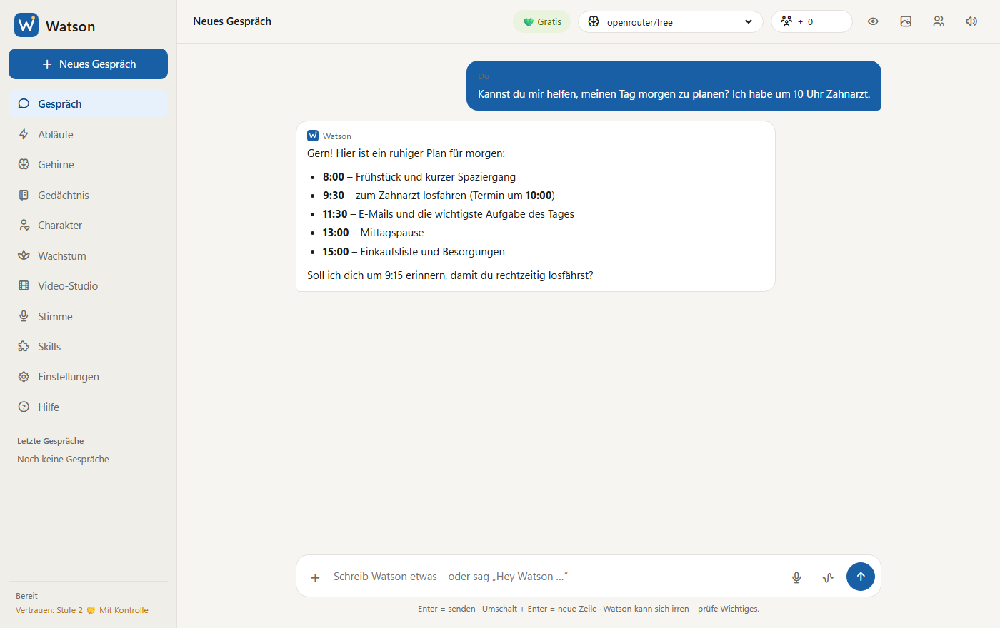
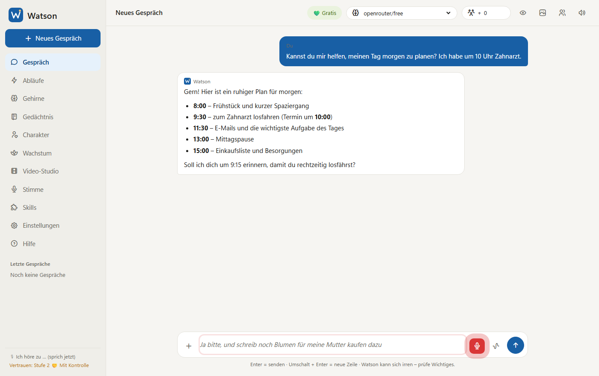
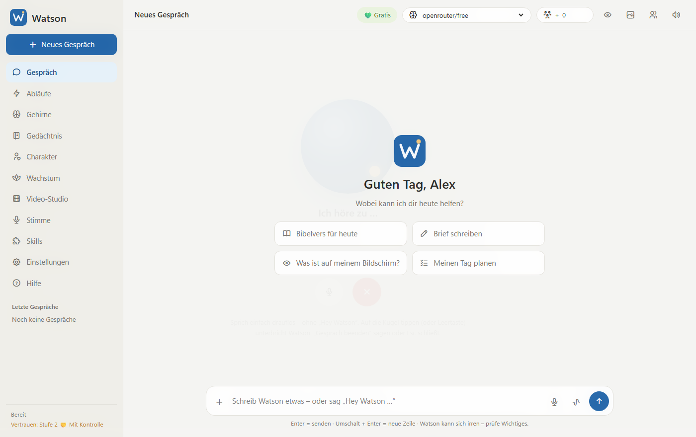

# Watson – dein persönlicher Assistent für Windows

*[English version: README.md](README.md)*

Watson ist ein persönlicher KI-Assistent, der auf deinem Windows-Computer wohnt – im Geist von J.A.R.V.I.S. oder K.I.T.T.
Er hört zu, spricht, merkt sich Dinge für dich, kann deinen Bildschirm lesen und – nur mit deiner Erlaubnis – für dich klicken und tippen.
Über einen privaten, verschlüsselten Tunnel kannst du auch vom Handy aus mit ihm reden.

> **Stand:** frühe Version, gebaut und getestet auf einem Windows-11-ARM-Laptop. Dort läuft sie täglich, auf vielen
> anderen Computern ist sie aber noch nicht getestet. Rückmeldungen sind willkommen.

## Bildschirmfotos

| Sprache zu Text: deine Worte erscheinen schon beim Sprechen | Gesprächsmodus: einfach reden, wie am Telefon |
|---|---|
|  |  |

Bildschirmfotos mit Beispieldaten

## Was Watson kann

- **Reden**: tippen oder sprechen. Der Gesprächsmodus ist wie ein Telefonat – Watson hört dauerhaft zu, antwortet mit Stimme und hört wieder zu. Mit dem Mikrofon-Knopf erscheinen deine Worte schon beim Sprechen im Eingabefeld.
- **Viele Sprachen**: Watson hört, antwortet und spricht in 36 Sprachen. Menüs gibt es auf Englisch und Deutsch.
- **Eigener Charakter**: Name, Anrede und Grundlage – *christlich (die Bibel als Maßstab)*, *ohne Religion (die Gesetze deines Landes als Maßstab)* oder selbst beschrieben.
- **Achtet das Gesetz**: Jeder Watson achtet die Gesetze des Landes, in dem du wohnst. Er sagt ehrlich, dass er nicht jedes Gesetz kennt, und verweist bei heiklen Dingen auf offizielle Stellen oder Fachleute.
- **Dein ChatGPT-Plan (freiwillig, neu)**: Hast du ChatGPT Plus oder Pro, kann Watson damit denken – „Mit ChatGPT anmelden“ drücken, im Browser erlauben, fertig. Das nutzt OpenAIs offizielles „Sign in with ChatGPT“ für Open-Source-Programme; kein API-Schlüssel, Watson sieht deine ChatGPT-Gespräche nicht. Ist dein Kontingent aufgebraucht, nimmt Watson von selbst die Gratis-Gehirne. *Mit nachgemachtem Server getestet, mit echtem ChatGPT-Konto noch nicht – Rückmeldungen willkommen.*
- **Kostenlose KI-Gehirne**: Standardmäßig nutzt Watson kostenlose Modelle über [OpenRouter](https://openrouter.ai). Ein „Dirigent“ wählt pro Frage das passende Gehirn. Bezahlte Modelle nur, wenn du sie einschaltest.
- **Gedächtnis**: Gespräche, Merkzettel, Wissensbuch und gelernte Fertigkeiten – alles lokal gespeichert. Ein kleines Modell auf dem PC sucht nach *Bedeutung* („Bin ich verheiratet?“ findet „Der Nutzer hat eine Frau“), und das Gedächtnis arbeitet in Stufen: ein kleiner Kern ist immer dabei, das große Archiv nur in passenden Ausschnitten – so bleibt Watson schnell.
- **Team für Recherche-Aufgaben**: Bei Plänen, Vergleichen, Käufen, Kosten oder Rechtsfragen arbeitet Watson mit einem Team an einem gemeinsamen Arbeitsbrett – ein Chef plant, Rechercheur (mit echten Internet-Quellen, ohne Wikipedia) und Rechner arbeiten gleichzeitig, ein Texter antwortet und ein Prüfer kontrolliert. Warnungen (z. B. „Kosten nur geschätzt“) stehen immer sichtbar da. Dauert etwa 2–4 Minuten, abschaltbar.
- **Schnelle Entscheidungen auf dem PC**: Kleine Ja/Nein-Entscheidungen (Team oder nicht? Gibt es etwas Neues zu merken?) trifft Watson lokal in Millisekunden statt ein KI-Gehirn zu fragen – das spart Gratis-Anfragen.
- **Augen und Hände**: Bildschirm als Text lesen, Programme öffnen, klicken und tippen – mit vier Vertrauens-Stufen und festen Grenzen (nie Passwörter, Bank oder Bezahlen; Senden, Löschen und Kaufen werden immer bestätigt).
- **Werkzeuge**: Werkzeuge über das Model Context Protocol (MCP) einstecken, optional Abläufe mit n8n.
- **Handy**: Chat, Stimme und Erlaubnis-Fragen auf dem Handy über Tailscale, geschützt mit Passwort und Fingerabdruck (Passkeys) – auf Wunsch mit Zwei-Schritt-Anmeldung (Authenticator-App oder E-Mail-Code, dazu Ersatz-Codes).
- **Video-Studio**: Clips schneiden und zusammenfügen, Untertitel automatisch (vorher verbesserbar), Musik, Logo und Text, das richtige Format für 14 Kanäle – auf „Veröffentlichen“ drückt immer ein Mensch. Auch am Handy. Dazu eine Übersicht über KI-Video-Plattformen (kostenlos und bezahlt) für alle, die nicht wissen, was es gibt.
- **Lernt wie ein Mensch**: Watson bildet sich aus dem, was er erfahren und geprüft hat, eine eigene Meinung und ändert sie offen, wenn neue Belege kommen. Quellen werden kritisch geprüft – eine Mehrheit ist kein Beweis, Wikipedia wird nicht als Quelle benutzt. Immer gemessen an dem Maßstab, den du gewählt hast.
- **Wächst mit der Zeit**: nächtliche Abendrunde und Selbststudium, Selbst-Prüfung, neue kostenlose Modelle testen und vorsichtige Selbst-Reparatur (nur mit deinem OK).
- **Sucht selbst im Internet**: Braucht Watson aktuelle oder genaue Fakten, sucht er mitten im Gespräch, liest die besten Seiten wirklich (ohne Wikipedia) und nennt seine Quellen – klar getrennt: gelesene Seiten und bloße Suchtreffer.
- **Tat-Prüfung**: Watson darf nur sagen „Ich habe … geöffnet / gesendet / gespeichert“, wenn es wirklich in seinem Protokoll steht. Sonst muss er es wirklich tun oder sich korrigieren – sonst erscheint ein sichtbarer Hinweis unter der Antwort. Er bietet auch nur an, was seine Werkzeuge wirklich können.
- **Herzschlag**: Alle 20 Minuten schaut Watson selbst nach – Termine, Sicherung (macht sie selbst, wenn fällig), Speicherplatz, Gehirne erreichbar, Abläufe (startet n8n neu), hängende Aufträge, Fehler. Kostet nichts (kein KI-Gehirn). Wichtiges meldet er von selbst; nachts bleibt er still und sagt es dir morgens.
- **Meinungsbuch**: Watson bildet eigene Meinungen mit Begründung, wie sicher er ist und – wo es passt – Bibelstellen, und darf umdenken; jede Änderung bleibt mit Grund sichtbar.
- **Fehlerbuch**: Watson schreibt seine Fehler auf (Tat-Prüfung, 👎, deine Korrekturen) und macht nachts aus dem Muster dahinter eine Lehre. Bei ähnlichen Fragen erinnert er sich an frühere Fehler.
- **Widerspruchs-Prüfung (neu)**: Nachts sucht Watson in Wissensbuch, Merkzettel und Meinungsbuch nach Einträgen, die sich widersprechen, doppelt oder veraltet sind. Er ändert nichts, er markiert nur. Funde im Wissen und Merkzettel erscheinen im Tagebuch mit „Geklärt“ / „Kein Widerspruch“ – *du* entscheidest; seine eigenen Meinungen bedenkt er selbst neu. In Antworten sagt er ehrlich, wenn ein Eintrag umstritten ist.
- **Spart Tokens (neu)**: Watson schickt nur die Werkzeug-Beschreibungen mit, die zur Frage passen (z. B. den n8n-Baukasten nur, wenn es um Abläufe geht), und lädt bei Bedarf selbst weitere Werkzeug-Gruppen nach. Alte Werkzeug-Ergebnisse und lange alte Nachrichten werden gekürzt. Gemessen: eine typische Anfrage von etwa 34.000 auf etwa 11.700 Tokens – schnellere Antworten, seltener an Gratis-Grenzen.
- **Versteht YouTube-Videos (neu)**: Schick Watson einen YouTube-Link, und er liest den gesprochenen Text (Untertitel) mit Titel und Kanal – kostenlos, ohne Konto. Er sagt ehrlich, dass er nur das Gesagte kennt, nicht die Bilder.
- **Oberprüfer für Selbst-Reparaturen (neu)**: Schlägt Watsons Wartungs-Team eine Code-Reparatur vor und der Code-Rat aus Gratis-Gehirnen stimmt zu, prüft zuerst ein Oberprüfer mit der *ganzen* Datei und allen Stellen, die sie benutzen – ChatGPT, wenn du deinen ChatGPT-Plan verbunden hast, sonst der Entwickler in der Werkstatt. Erst nach einem Ja wirst du gefragt; ohne dein OK ändert sich nie etwas.
- **Selbsttest jede Nacht (neu)**: Watson prüft nachts leise seine 10 wichtigsten Fähigkeiten – Gratis-Gehirn, Internet-Suche, YouTube, Gedächtnis, Datenbank, Handy-Seite, Handy-Tunnel, Abläufe (n8n), Stimme (nur erzeugt, nie abgespielt) und Sicherung. Geht etwas nicht, sagt der Herzschlag es dir am Morgen. Kostenlos und lautlos.
- **Klügere Wartung (neu)**: Fehler von vor der letzten Änderung einer Datei gelten nicht mehr als neu – keine Reparatur-Vorschläge mehr für längst Behobenes.
- **Schneller, wenn ein Gratis-Gehirn hängt (neu)**: Antworten kommen Stück für Stück; zeigt ein Gratis-Gehirn nach 25 Sekunden kein Lebenszeichen, nimmt Watson sofort das nächste und sagt es dir. Erinnerungen vom Herzschlag kommen höchstens 1× am Tag und höchstens 3×.
- **Erfinder-Zeit und Programmier-Schule (neu)**: Nachts lernt Watson besser programmieren, erforscht, womit Menschen Mühe haben, und denkt sich Ideen aus; Programm-Ideen probiert er in einer abgeschotteten Kiste aus (Docker im WSL: kein Internet, keine Dateien vom Computer). Eine wöchentliche Programmier-Prüfung wählt die kostenlosen Gehirne, die am besten programmieren. *Braucht Docker im WSL – ohne Docker können die Probeprogramme nicht laufen.*

## Installation

1. **Herunterladen:** `Watson-Setup.exe` aus der neuesten Version:
   **[Releases → neueste Version](../../releases/latest)**
2. `Watson-Setup.exe` starten. Windows SmartScreen zeigt eventuell *„Der Computer wurde durch Windows geschützt“*,
   weil der Installer nicht digital signiert ist – dann auf **Weitere Informationen → Trotzdem ausführen** klicken.
3. Administrator-Rechte sind nicht nötig. Der Einrichtungs-Assistent fragt, wo du wohnst, welche Sprache Watson
   sprechen soll, deinen Namen und welche Grundlage Watson haben soll, zeigt einen Datenschutz-Hinweis und
   installiert dann alles (meist wenige Minuten, mit Zeitanzeige). Internet ist dabei nötig.
4. Beim ersten Start hilft Watson dir, einen kostenlosen OpenRouter-Schlüssel anzulegen (etwa 2 Minuten).

Voraussetzungen: Windows 10 oder 11 (64 Bit), etwa 3 GB freier Speicher, Mikrofon und Lautsprecher für die Stimme.

*Selbst bauen:* `installer\bauen.ps1` in PowerShell ausführen – erzeugt `installer\Ausgabe\Watson-Setup.exe`.

## Datenschutz

- **Bleibt auf deinem Computer:** Gespräche, Gedächtnis, Einstellungen, Aufnahmen, Stimmen. Schlüssel liegen verschlüsselt in der Windows-Anmeldeinformationsverwaltung.
- **Geht ins Internet:** Die Fragen, die du Watson stellst, gehen an OpenRouter und die KI-Modelle dort, damit Watson denken kann. Teile in Gesprächen keine Passwörter oder sehr privaten Daten.
- **Einmal geladen:** Die Sprach-Modelle (Whisper, Kokoro) und das kleine Bedeutungs-Modell (multilingual-e5-small) werden beim ersten Gebrauch einmal von Hugging Face geladen und laufen dann auf deinem PC.
- Texte auf Webseiten oder dem Bildschirm sind nie Befehle – nur du gibst Watson Aufträge.

## Ehrliche Grenzen

- Die kostenlosen KI-Modelle sind manchmal langsam oder überlastet; Watson nimmt dann automatisch ein anderes.
- Die Spracherkennung braucht auf einem normalen Laptop-Prozessor ein paar Sekunden.
- Watson kann sich irren. Prüfe Wichtiges selbst.

## Lizenz

Watson ist freie Software unter der **GNU General Public License v3.0** – siehe [LICENSE](LICENSE).
Fremde Bausteine und ihre Lizenzen: siehe [THIRD_PARTY.md](THIRD_PARTY.md).
